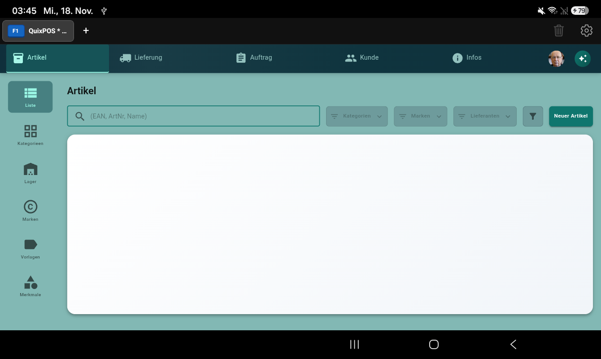
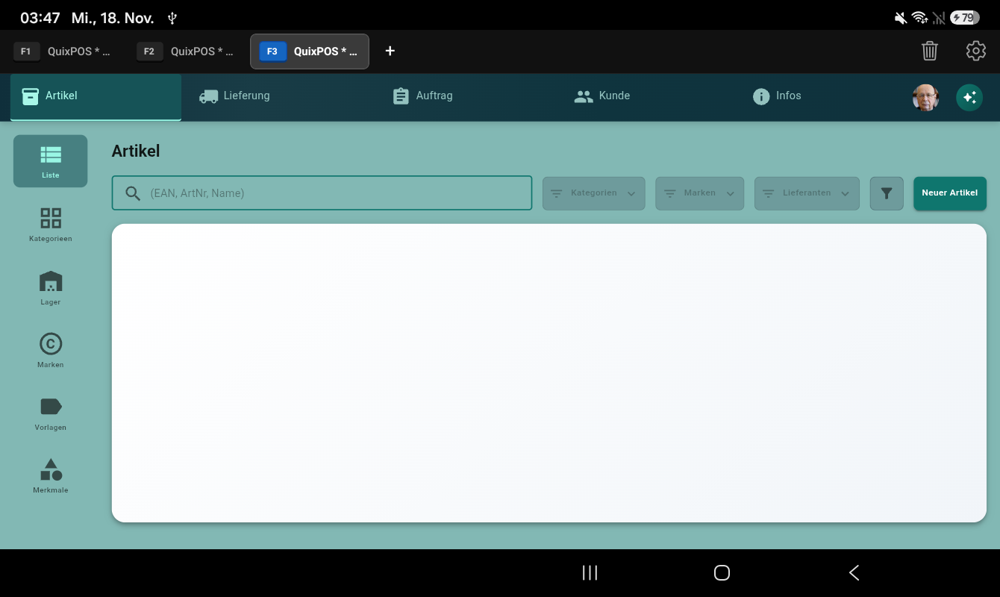
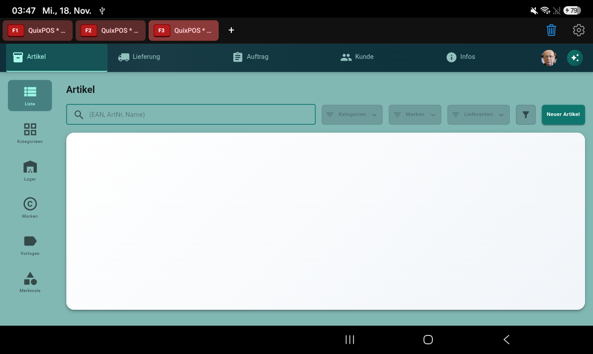
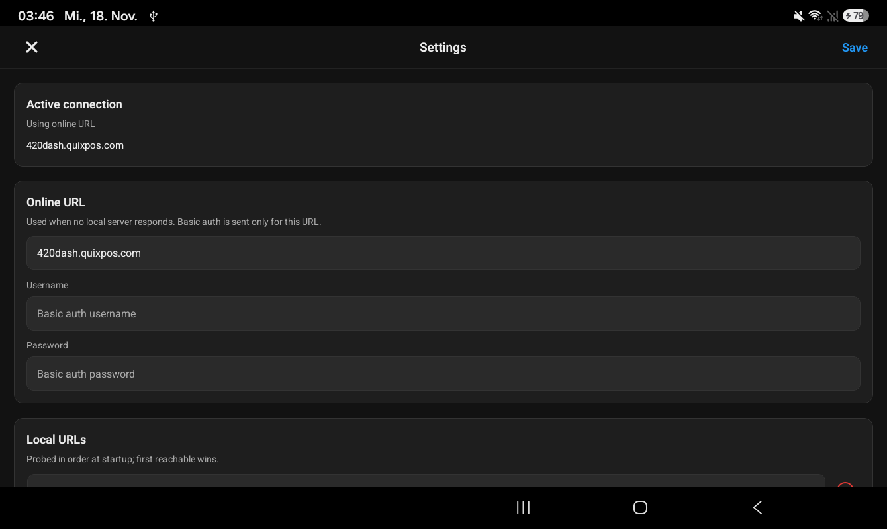
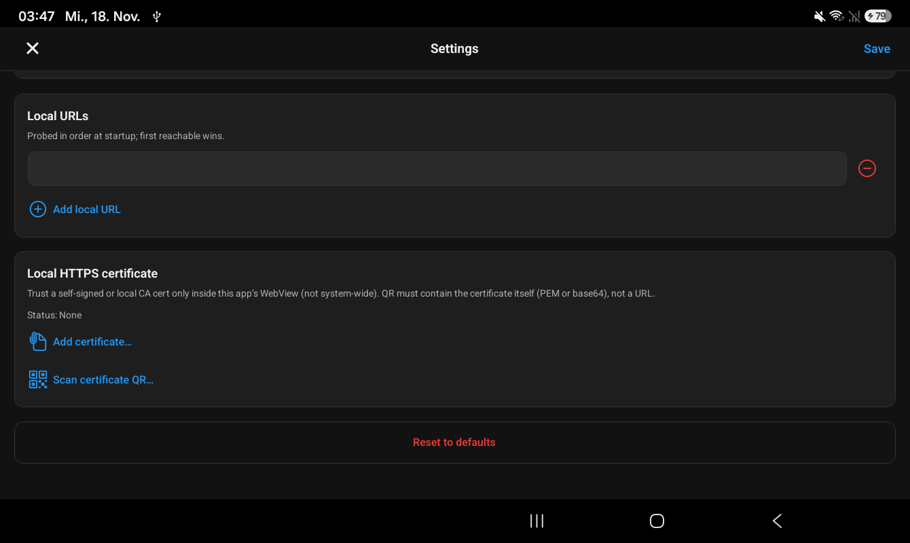

# WebWrap

**[Download Latest APK (`arm64-v8a`)](https://github.com/quixpos/webwrapapp/releases/latest/download/app-arm64-v8a-release.apk)** · [All Releases / Other ABIs (`armeabi-v7a`, `x86_64`, `x86`)](https://github.com/quixpos/webwrapapp/releases/latest)

A React Native Android wrapper for turning any web app or dashboard into a multi-tab, keyboard-friendly tablet/phone application.

## Screenshots

| Main View (`F1`) | Multi-Tab (`F1`–`F3`) |
| --- | --- |
|  |  |

| Tab Close Mode | Settings — Connection & Auth | Settings — Local URLs & HTTPS Cert |
| --- | --- | --- |
|  |  |  |

## Features

- **Multi-Tab F-Key Workspace (`F1`–`F12`)**: Native top tab bar with `+` to open tabs, automatic `document.title` syncing, and a guarded trash-mode toggle to prevent accidental tab closes.
- **Hardware Keyboard Support**:
  - `F1`–`F12` (or `Ctrl+1`–`Ctrl+9`, `Ctrl+0`, `Ctrl+-`, `Ctrl+=`) switch to or create tabs `1`–`12`.
  - Arrow keys and `Escape` (as well as Android Back) are forwarded directly to the active WebView while keeping keyboard focus inside the page.
- **Local-First URL Resolution & Basic Auth**:
  - Probes configured local URLs concurrently on startup (`GET /`, 5 s timeout) and connects to the first reachable server.
  - Falls back to the configured Online URL with optional HTTP Basic Authentication (credentials are only sent to the online URL).
- **App-Scoped Local HTTPS Certificates**:
  - Import a self-signed or local CA certificate via file picker or QR code scanner (`Settings` → `Local HTTPS certificate`).
  - Certificates are trusted only inside WebWrap's own WebView—never installed system-wide.
- **Native WebView Bridges**:
  - **Clipboard Image Read**: Polyfills `navigator.clipboard.read()` to return `image/png` `ClipboardItem`s from the Android clipboard even on `http://` origins.
  - **Google Sign-In**: Exposes `window.__dashHost.requestGoogleIdToken(clientId)` backed by native Android Google Sign-In.
- **Kiosk & Display Ergonomics**:
  - Automatic viewport scaling (`0.85` on ≥ 7″ tablets, `0.65` on phones).
  - Keeps the screen awake while the app is open.

## Getting Started

### Prerequisites

- Node.js `>= 22.11.0`
- Android SDK & an Android device or emulator connected via `adb`

### Install & Run

```bash
npm install
npm start
```

In a second terminal:

```bash
npm run android
```

### Build APK

```bash
# Release APK (uses scripts/apk-release.sh)
npm run apk
npm run apk:install

# Debug APK
npm run apk:debug
npm run apk:debug:install
```

> **Windows note**: `scripts/apk-release.sh` builds through a short directory junction (`C:\da`) so Ninja/CMake object paths stay under the Windows `MAX_PATH` limit.

### Checks

```bash
npm run lint
npm test
```

## Configuration

Open the **Settings** screen (gear icon in the top-right corner) to configure:

1. **Online URL & Basic Auth**: Fallback URL and optional username/password used when no local server responds.
2. **Local URLs**: Ordered list of LAN/local server URLs probed at startup.
3. **Local HTTPS Certificate**: Load a certificate file or scan a certificate QR code (PEM/base64) to trust local HTTPS servers inside the WebView.
